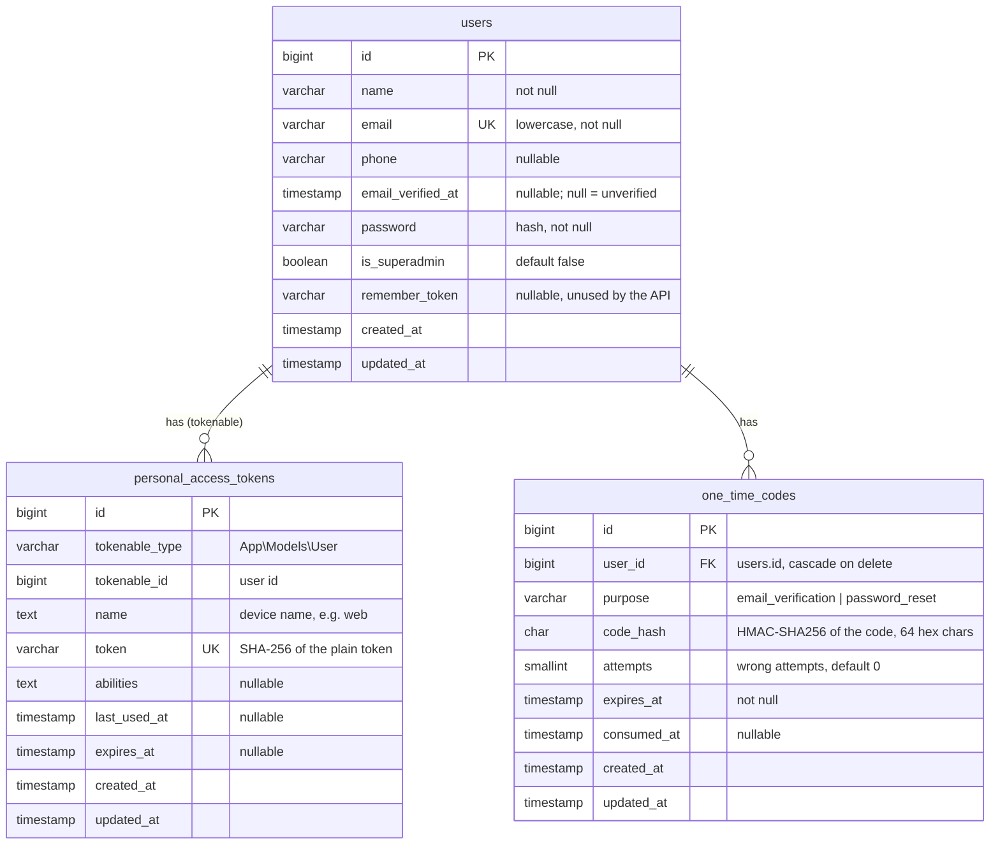

# User authentication: database structure

**Related:** [PRD](prd.md) · [Business rules](../../business/business-rules.md)

PostgreSQL 18. Tables are created by Laravel migrations in `backend/database/migrations/`.

## Diagram

## Tables

### `users`

A person who can log in. Users are global: they are not owned by a company (business rules §2.4).

| Column | Type | Notes |
| --- | --- | --- |
| `id` | `bigint` PK | |
| `name` | `varchar(255)` | Required |
| `email` | `varchar(255)` unique | Always stored in lowercase (AUTH-1) |
| `phone` | `varchar(30)` nullable | Added by this feature. Free-form, validated in the form request |
| `email_verified_at` | `timestamp` nullable | `null` means unverified |
| `password` | `varchar(255)` | Bcrypt hash (AUTH-2) |
| `is_superadmin` | `boolean` default `false` | Platform Superadmin (business rules §4.1). Not mass-assignable. Set by `SuperadminSeeder` or platform user management (UM-4 to UM-6) |
| `status` | `varchar(16)` default `pending`, indexed | `pending`, `active` or `inactive`. Added by [user management](../user-management/erd.md) |
| `last_login_at` | `timestamp` nullable, indexed | Last successful login (AUTH-18). Added by [user management](../user-management/erd.md) |
| `remember_token` | `varchar(100)` nullable | Laravel default. Unused by the token-based API |
| `created_at`, `updated_at` | `timestamp` | |

### `personal_access_tokens`

Laravel Sanctum tokens, one per logged-in device. Polymorphic, but only `App\Models\User` owns tokens for now. Logout deletes one row (AUTH-12), and a password reset deletes all rows for the user (AUTH-10).

Indexes: `token` unique, `(tokenable_type, tokenable_id)`, `expires_at`.

### `one_time_codes`

Short-lived email codes for verification and password reset (AUTH-4 to AUTH-8).

| Column | Type | Notes |
| --- | --- | --- |
| `id` | `bigint` PK | |
| `user_id` | `bigint` FK → `users.id` | `ON DELETE CASCADE` |
| `purpose` | `varchar(32)` | `App\Enums\OneTimeCodePurpose`: `email_verification`, `password_reset` |
| `code_hash` | `char(64)` | `hash_hmac('sha256', code, APP_KEY)`. The plain code is never stored |
| `attempts` | `smallint` default `0` | Wrong attempts. The code is invalid at 5 (AUTH-6) |
| `expires_at` | `timestamp` | `created_at` + 10 minutes |
| `consumed_at` | `timestamp` nullable | Set when the code is used successfully |
| `created_at`, `updated_at` | `timestamp` | `created_at` drives the resend cooldown (AUTH-7) |

Index: `(user_id, purpose)`, for looking up the latest code.

A code is **valid** when `consumed_at IS NULL`, `expires_at > now()` and `attempts < 5`. Issuing a new code deletes the user's earlier codes for the same purpose (AUTH-5). Rows that expired more than a day ago are pruned daily (`model:prune`).

## Laravel default tables not used by this feature

- `password_reset_tokens`: Laravel's link-based reset. Recovery uses `one_time_codes` instead. Kept for framework compatibility.
- `sessions`: used only by the web guard. The API is stateless.
- `cache`, `cache_locks`, `jobs`, `job_batches`, `failed_jobs`: infrastructure. Rate limiters use the cache, and verification emails are queued in `jobs`.

## Future relationships

Company memberships and branch access (business rules §2.5 and §2.6) will reference `users.id`. Deleting or deactivating a user must then respect MB-5.

Registration and verification write to `audit_logs` ([user management ERD](../user-management/erd.md)).
