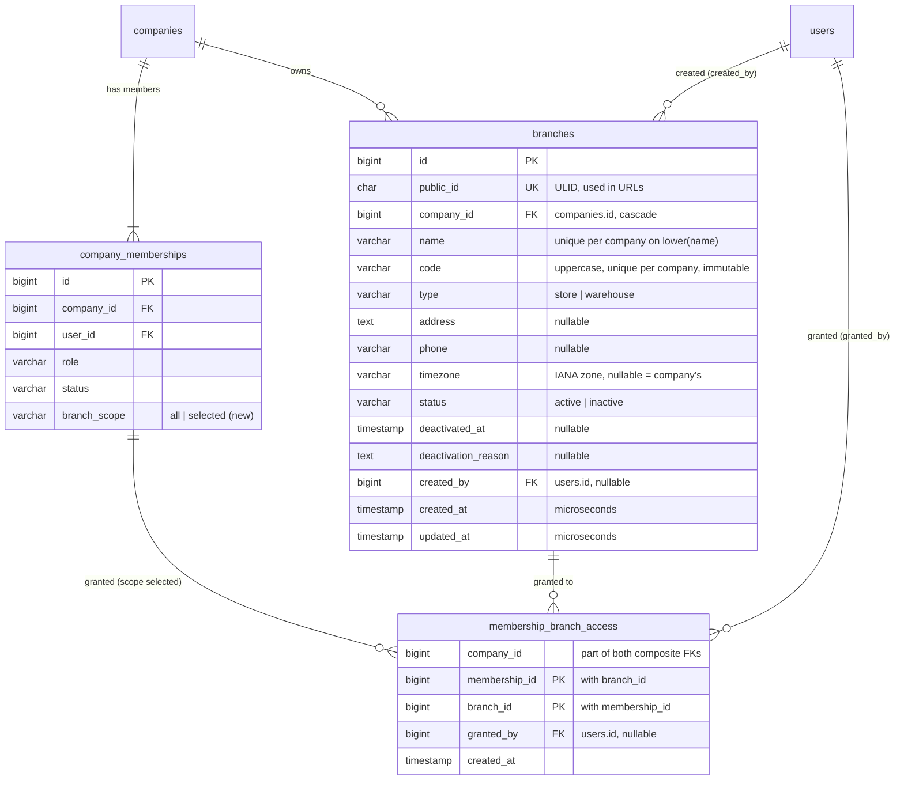

# Branch management: database structure

**Related:** [PRD](prd.md) · [Company management ERD](../company-management/erd.md) · [Company workspace ERD](../company-workspace/erd.md) · [Tenancy](../../architecture/tenancy.md) · [Audit logging](../../architecture/audit-logging.md)

PostgreSQL 18. This feature adds `branches` and `membership_branch_access`, and adds `branch_scope` to `company_memberships`.

## Diagram

## `branches`

A store or warehouse of one company (business rules §2.2–2.3, BM-1).

| Column | Type | Notes |
| --- | --- | --- |
| `id` | bigint, PK | Internal key, never exposed |
| `public_id` | char(26), unique | ULID, the branch's ID in the API |
| `company_id` | bigint, FK `companies.id`, cascade | Never changes (BM-1) |
| `name` | varchar(100) | Unique per company, ignoring case |
| `code` | varchar(20) | Uppercase, immutable (BM-2) |
| `type` | varchar(16), default `store` | `store` or `warehouse` |
| `address` | text, nullable | |
| `phone` | varchar(30), nullable | |
| `timezone` | varchar(64), nullable | `null` uses the company's (BM-9) |
| `status` | varchar(16), default `active` | `active` or `inactive` (BM-6) |
| `deactivated_at`, `deactivation_reason` | timestamp, text, nullable | Set on deactivation, cleared on reactivation |
| `created_by` | bigint, FK `users.id`, null on delete | |
| `created_at`, `updated_at` | timestamp(6) | Microseconds for optimistic concurrency |

Indexes and constraints:

- `UNIQUE (company_id, id)`: the target for composite foreign keys from branch-scoped tables ([tenancy](../../architecture/tenancy.md)).
- `UNIQUE (company_id, code)`: codes are stored uppercase, so this is case-insensitive (BR-2).
- `branches_company_name_lower_unique`: `UNIQUE (company_id, lower(name))`.
- `INDEX (company_id, status)` for lists.
- `CHECK` constraints: `branches_code_format` (`^[A-Z0-9][A-Z0-9-]{1,19}$`), `branches_type_check`, `branches_status_check`.

Rows are never deleted by the application (BM-7).

## `company_memberships.branch_scope` (new column)

| Column | Type | Notes |
| --- | --- | --- |
| `branch_scope` | varchar(16), default `selected` | `all` or `selected`, `CHECK company_memberships_branch_scope_check` (BM-3) |

- The migration set existing Owners and Admins to `all`; everyone else kept `selected` with no branches (BM-4).
- Code that creates a membership sets it from `MembershipRole::defaultBranchScope()`. The column default `selected` is the safe side if it doesn't.
- The Owner reaches every branch whatever is stored (BR-3). Ownership transfer stores `all` on both memberships.
- `UNIQUE (company_id, id)` was added as the target for the composite foreign key below.

## `membership_branch_access`

The branches a membership with scope `selected` may work in.

| Column | Type | Notes |
| --- | --- | --- |
| `company_id` | bigint | Shared by both composite foreign keys |
| `membership_id` | bigint | PK with `branch_id` |
| `branch_id` | bigint | PK with `membership_id` |
| `granted_by` | bigint, FK `users.id`, null on delete, nullable | Who granted it |
| `created_at` | timestamp | |

Constraints:

- `PRIMARY KEY (membership_id, branch_id)`.
- `FOREIGN KEY (company_id, membership_id) → company_memberships (company_id, id) ON DELETE CASCADE`.
- `FOREIGN KEY (company_id, branch_id) → branches (company_id, id) ON DELETE CASCADE`.
- `INDEX (company_id, branch_id)` for "who can work in this branch".

The two composite keys share `company_id`, so a row can't link a membership and a branch of different companies (BM-8). Every later branch-scoped table (stock, sales, receipts) follows the same pattern: `(company_id, branch_id) → branches (company_id, id)`.

Rows are replaced as a whole when access changes (BM-5) and kept when a membership is deactivated (BM-11). Memberships are never deleted (CW-5), so the cascade only matters if a company is deleted.

## `audit_logs`

No schema change. New actions with `company_id` set: `branch.created`, `branch.updated`, `branch.deactivated`, `branch.reactivated` (subject: the branch) and `branch_access.updated` (subject: the membership). See [audit logging](../../architecture/audit-logging.md).

## Relationships to other features

- Branch-scoped tables in later modules carry `company_id` and `branch_id`, with a composite foreign key to `branches (company_id, id)`, and use the `company.branch` and `branch.active` middleware ([tenancy](../../architecture/tenancy.md)).
- Transfers between locations reference two branches of the same company (WH-6), both through composite keys sharing `company_id`.
