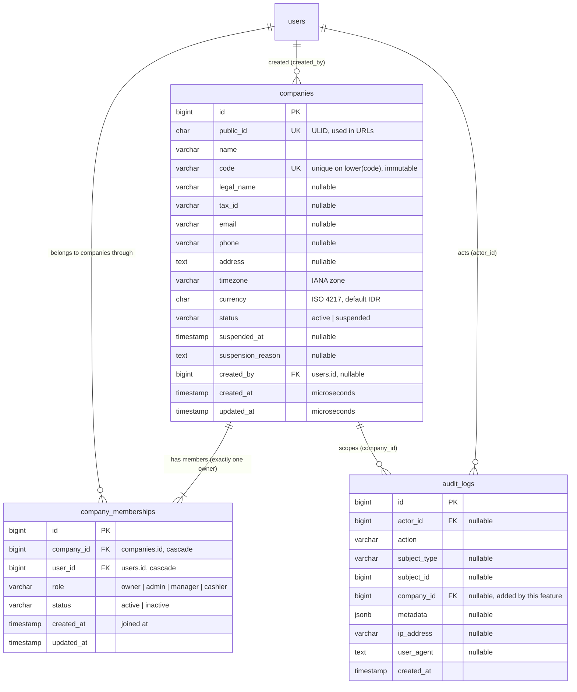

# Platform company management: database structure

**Related:** [PRD](prd.md) · [User management ERD](../user-management/erd.md) · [Tenancy](../../architecture/tenancy.md) · [Audit logging](../../architecture/audit-logging.md)

PostgreSQL 18. This feature adds `companies` and `company_memberships`, and scopes `audit_logs` by company.

## Diagram

## `companies`

| Column | Type | Notes |
| --- | --- | --- |
| `id` | `bigint` PK | Internal only, never exposed |
| `public_id` | `char(26)` unique | ULID, generated on create (`HasUlids` with `uniqueIds()`), the route key |
| `name` | `varchar(150)` | Index on `lower(name)` for search and sort |
| `code` | `varchar(40)` | Unique index on `lower(code)`. `CHECK (code ~ '^[a-z][a-z0-9-]{2,39}$')`. Immutable (CM-8) |
| `legal_name` | `varchar(200)` nullable | |
| `tax_id` | `varchar(50)` nullable | |
| `email` | `varchar(255)` nullable | Contact address |
| `phone` | `varchar(30)` nullable | |
| `address` | `text` nullable | Up to 500 characters (validated) |
| `timezone` | `varchar(64)` | IANA zone |
| `currency` | `char(3)` default `IDR` | ISO 4217 |
| `status` | `varchar(16)` default `active`, indexed | `CHECK (status IN ('active','suspended'))` |
| `suspended_at` | `timestamp` nullable | |
| `suspension_reason` | `text` nullable | |
| `created_by` | `bigint` FK → `users.id`, nullable | `ON DELETE SET NULL` |
| `created_at`, `updated_at` | `timestamp(6)` | Microsecond precision, so optimistic concurrency (CM-11) catches two edits in the same second. Index on `created_at` |

Companies are never deleted (CM-9).

## `company_memberships`

| Column | Type | Notes |
| --- | --- | --- |
| `id` | `bigint` PK | |
| `company_id` | `bigint` FK → `companies.id` | `ON DELETE CASCADE` |
| `user_id` | `bigint` FK → `users.id` | `ON DELETE CASCADE`, indexed |
| `role` | `varchar(16)` | `App\Enums\MembershipRole`. `CHECK (role IN ('owner','admin','manager','cashier'))` |
| `status` | `varchar(16)` default `active` | `App\Enums\MembershipStatus`. `CHECK (status IN ('active','inactive'))` |
| `branch_scope` | `varchar(16)` default `selected` | `all` or `selected`; added by [branch management](../branch-management/erd.md) |
| `created_at`, `updated_at` | `timestamp` | `created_at` is the joined date |

Constraints:

- `UNIQUE (company_id, user_id)`: a user has at most one membership per company.
- `UNIQUE (company_id, id)`: the target for `membership_branch_access`'s composite foreign key (added by branch management).
- **Partial unique index** `company_memberships_one_owner` on `(company_id) WHERE role = 'owner'`: at most one owner per company. "At least one" holds because a company is created with its owner in one transaction and ownership only moves (CM-3). A transfer demotes the old owner before promoting the new one, inside one transaction.

## Changes to `audit_logs`

| Column | Type | Notes |
| --- | --- | --- |
| `company_id` | `bigint` FK → `companies.id`, nullable | `ON DELETE SET NULL`. Set for company-level actions |

Index: `(company_id, created_at)` for a company's activity, newest first.

## Relationships to other features

- `users` (auth, user management): users join companies through memberships. Platform user management shows `companies_count`, the "has company" filter and a user's memberships from this table, and blocks deactivating an owner (CM-14, MB-5).
- Tenant-owned tables carry a non-null `company_id` and use composite foreign keys where children reference other tenant rows ([tenancy](../../architecture/tenancy.md)). `branches` is the first ([branch management ERD](../branch-management/erd.md)).
- `membership_branch_access` references `company_memberships (company_id, id)`, and memberships gained `branch_scope` (business rules §2.6).
