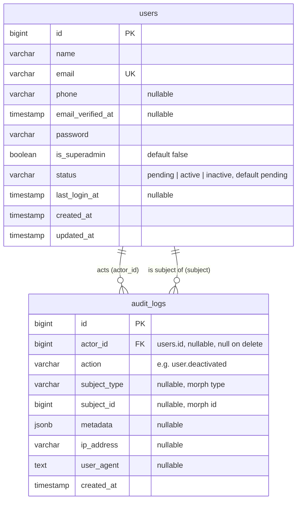

# Platform user management: database structure

**Related:** [PRD](prd.md) · [Auth ERD](../auth/erd.md) · [Business rules](../../business/business-rules.md)

PostgreSQL 18. This feature adds account status and login tracking to `users`, and introduces the platform-wide `audit_logs` table (SEC-5).

## Diagram

## Changes to `users`

| Column | Type | Notes |
| --- | --- | --- |
| `status` | `varchar(16)` default `pending`, indexed | `App\Enums\UserStatus`. Lifecycle in PRD §3. Not mass-assignable |
| `last_login_at` | `timestamp` nullable, indexed | Set on each successful login and on registration (UM-11). Written without touching `updated_at` |

An index was also added on `created_at`, for the registration date filter and sort.

**Backfill:** users with `email_verified_at` became `active`, and the rest became `pending`.

## `audit_logs`

An append-only record of sensitive actions, shared by every feature. Rows are never updated or deleted by the application.

| Column | Type | Notes |
| --- | --- | --- |
| `id` | `bigint` PK | |
| `actor_id` | `bigint` FK → `users.id`, nullable | Who performed the action. `null` for system actions. `ON DELETE SET NULL` keeps the history |
| `action` | `varchar(64)` | `App\Enums\AuditAction`, e.g. `user.deactivated` |
| `subject_type`, `subject_id` | morph, nullable | What the action was performed on, e.g. `App\Models\User` + id |
| `metadata` | `jsonb` nullable | Extra context, e.g. `{ "previous_status": "active" }` |
| `ip_address` | `varchar(45)` nullable | Request IP |
| `user_agent` | `text` nullable | Request user agent |
| `created_at` | `timestamp` | When it happened. There is no `updated_at` |

Indexes: `(subject_type, subject_id, created_at)` for a subject's history, `actor_id`, and `action`.

Actions recorded by this feature and auth: `user.registered`, `user.created`, `user.email_verified`, `user.deactivated`, `user.reactivated`, `user.superadmin_granted`, `user.superadmin_revoked`.

A nullable `company_id` column (added by [company management](../company-management/erd.md)) scopes company-level entries, so a company's audit trail can be read without crossing tenants (SEC-1).

## Relationships

- `company_memberships` references `users.id` ([company management ERD](../company-management/erd.md)). The user list counts active memberships (`companies_count`) and filters on them (`company=has|none`); user details list them. `audit_logs` gained a nullable `company_id` for company-level entries.
- A `users.public_id` column (e.g. `USR-1024`, unique) is planned for public identifiers. Search will match it exactly.
